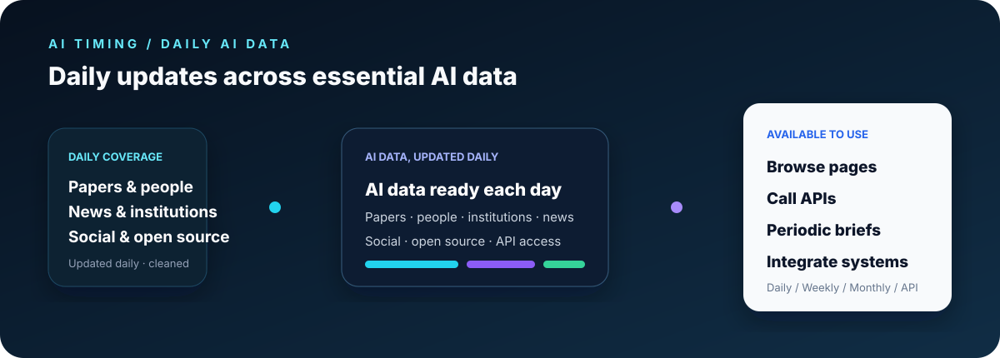
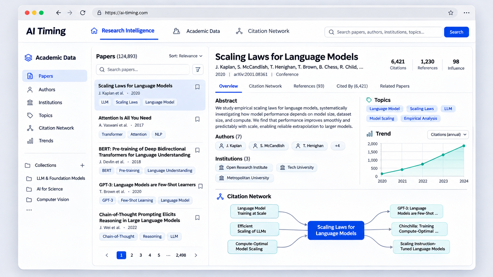
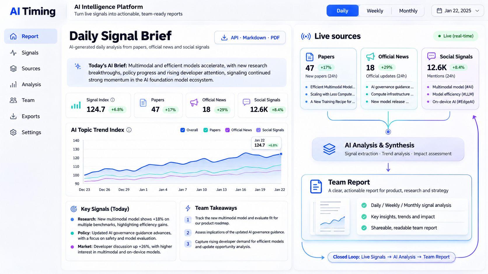
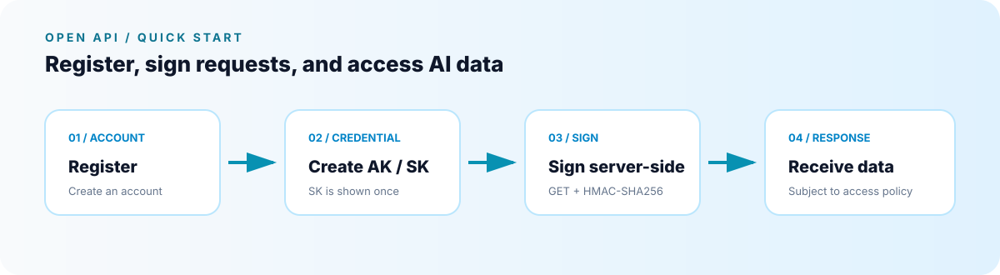
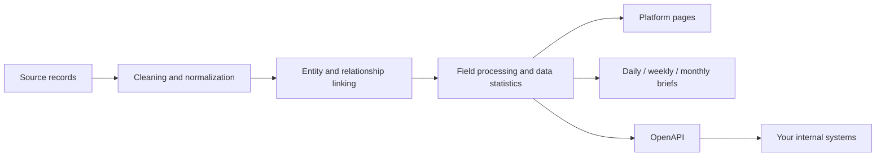
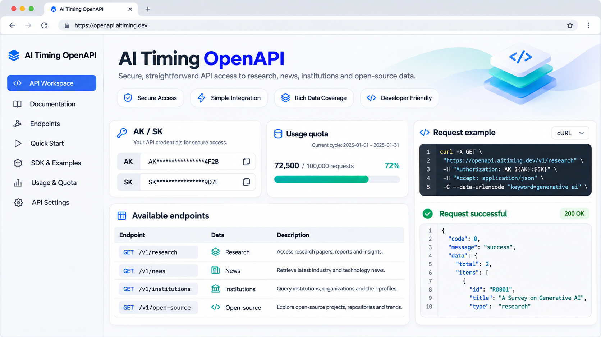

# AI Timing

**English** | [简体中文](./README.zh-CN.md)

> AI data search and API access for papers, people, institutions, news, public discussions, and open-source projects

[](https://aitiming.tech/platform)
[](https://aitiming.tech/open-api)

AI Timing brings together public and authorized information on papers, researchers, institutions, news, social media, and open-source projects. Records are cleaned, deduplicated, linked, and updated daily. You can browse the data on the platform or connect it to your own system through APIs.



## Available data

| Data area | Main fields | Common use |
|---|---|---|
| Papers | Title, abstract, authors, institutions, publication date, citations, and topic tags | Filter papers by author, institution, topic, and date |
| News | AI news title, summary, source, time, and category | Browse by source and date or prepare regular updates |
| Institutions | AI companies, organizations, labs, and related records | Review institution profiles, related papers, people, and projects |
| Social media | Public posts, publish time, source, topics, and interaction data | Follow public discussion around a topic, person, or project |
| Open source | Projects, repositories, descriptions, tags, and community metrics | Find project and repository information with community activity |

The data is cleaned and structured before delivery, with daily synchronization. Links between authors, institutions, papers, projects, and news remain queryable. It can be used in the platform, through an API, or in your own scripts and automation.

## Product previews

### Papers, authors, and institutions



From a paper record, continue to its authors, institutions, topics, citations, and related records.

### Daily, weekly, and monthly briefs



Papers, news, and social content in a selected time range can be organized into daily, weekly, or monthly briefs for viewing, sharing, downloading, and subsequent automation.

## Common uses

### Papers and author lookup

- Filter papers by topic, institution, author, and date
- Review citations, author collaboration, and institution relationships
- Collect public references for teaching, writing, and research materials

### Institutions, projects, and news

- Search institutions, labs, people, and open-source projects
- Browse AI news, community posts, and project updates by date and source
- Read papers, news, projects, and people related to the same topic together

### Product and commercial work

- Support product research, technology selection, partner screening, and customer profile enrichment
- Review public information on products, institutions, projects, and competitors
- Send data to BI, knowledge bases, internal search, CRM, or custom applications

### Individual developers and creators

- Build products, content topics, and domain research with public references
- Maintain a query list for a topic, person, institution, or open-source project
- Connect APIs to scripts, agents, newsletters, or automation workflows

### Periodic summaries and automation

- Access daily, weekly, and monthly brief previews and updates
- Gather papers, news, social discussion, and projects from a selected time range
- Use server-side API calls in automation and scheduled jobs

## Data processing and delivery





## OpenAPI access



### Apply for AK / SK

1. Register and sign in at the [AI Timing platform](https://aitiming.tech/platform)
2. Open [OpenAPI](https://aitiming.tech/open-api)
3. Read the public [user guide](https://aitiming.tech/open-api/guide)
4. Create an AK / SK in **Credential management**
5. Your Secret Key is displayed only once after creation or rotation. Copy it immediately and store it in a secure server-side environment variable
6. Review the available endpoints, quota cycle, usage, and remaining calls in **Available endpoints**

> Credential management, AK / SK creation, and endpoint access require sign-in. The user guide is public.

### Higher API quotas for universities and research institutions

University faculty, labs, and research institutions that need higher API quotas for teaching, research projects, lab data services, or internal system testing can scan the support QR code below to add us, or email `market@qingwuinfo.cn`. Please include your institution or team name, intended use, estimated call volume, and endpoint requirements. We will review the request and help arrange an appropriate quota and integration support.

## A note from the team

The goal is simple: make information scattered across papers, news, public discussions, and open-source communities easier to read, connect, and reuse.

AI Timing is maintained as a low-cost, interest-driven project. Free API access has reasonable call, rate, and concurrency limits to keep the public service stable. Students, faculty, open-source projects, and early-stage independent developers with higher volume, bulk data, or special integration needs are welcome to contact us using the channels below.

### Endpoints

```text
API Base: https://aitiming.tech/api
OpenAPI:  https://aitiming.tech/api/openapi/v1
```

### Request rules

- Business APIs currently support `GET` requests; request bodies are not supported
- Sign requests only on your own server. Do not expose an SK in a browser, app, or public repository
- Generate a new 10-digit Unix timestamp, unique nonce, and signature for every request
- The management console uses a sign-in token; business OpenAPI calls use AK / SK signatures. Do not mix the two authentication methods
- Use `/openapi/v1/**` for the signing path, without the deployment prefix `/api`
- Build `CanonicalQuery` according to the protocol: sort parameter names and apply the required URL encoding and empty-value handling
- Rate, user quota, endpoint daily quota, concurrency, and temporary blocking are set by platform policy
- On `429`, wait for the response-indicated period before retrying. Do not retry with dense parallel requests

Required request headers:

| Header | Description |
|---|---|
| `X-OpenApi-Access-Key` | AK issued by the platform |
| `X-OpenApi-Timestamp` | 10-digit Unix timestamp in seconds |
| `X-OpenApi-Nonce` | A unique random string for every request |
| `X-OpenApi-Signature` | HMAC-SHA256 signature |
| `X-OpenApi-Sign-Version` | Currently fixed at `v1` |

### Python request skeleton

The example shows the call structure only. Replace `AK`, `SK`, and the endpoint path with values assigned by the platform. Refer to the [user guide](https://aitiming.tech/open-api/guide) for the complete canonical query, signing string, and error handling requirements.

```python
import hashlib
import hmac
import os
import secrets
import time
import urllib.parse

import requests

BASE_URL = "https://aitiming.tech/api"
AK = os.environ["AITIMING_ACCESS_KEY"]
SK = os.environ["AITIMING_SECRET_KEY"]
PATH = "/openapi/v1/papers"
RAW_QUERY = "page=1&pageSize=20"

def rfc3986_encode(value: str) -> str:
    value = urllib.parse.unquote_plus(value, encoding="utf-8")
    return urllib.parse.quote(value, safe="-._~", encoding="utf-8")

def canonical_query(raw_query: str) -> str:
    if not raw_query:
        return ""
    pairs = []
    for pair in raw_query.split("&"):
        raw_name, separator, raw_value = pair.partition("=")
        if not separator:
            raw_value = ""
        pairs.append((rfc3986_encode(raw_name), rfc3986_encode(raw_value)))
    pairs.sort()
    return "&".join(f"{name}={value}" for name, value in pairs)

timestamp = str(int(time.time()))
nonce = secrets.token_hex(16)
empty_body_sha256 = hashlib.sha256(b"").hexdigest()
canonical_request = "\n".join([
    "OPENAPI-HMAC-SHA256", "v1", "GET", PATH,
    canonical_query(RAW_QUERY), timestamp, nonce, empty_body_sha256,
])
signature = hmac.new(SK.encode("utf-8"), canonical_request.encode("utf-8"), hashlib.sha256).hexdigest()

response = requests.get(
    BASE_URL + PATH + "?" + RAW_QUERY,
    headers={
        "X-OpenApi-Access-Key": AK,
        "X-OpenApi-Timestamp": timestamp,
        "X-OpenApi-Nonce": nonce,
        "X-OpenApi-Signature": signature,
        "X-OpenApi-Sign-Version": "v1",
    },
    timeout=30,
)
response.raise_for_status()
print(response.json())
```

> The signing string above is an integration outline. Production requests must follow the user guide’s complete CanonicalQuery, empty-body digest, and string-to-sign rules.

## Responses and error handling

Successful responses normally use this structure:

```json
{
  "code": 200,
  "message": "success",
  "data": {}
}
```

| Status | Meaning | Recommended action |
|---|---|---|
| `200` | Request succeeded | Read `data` |
| `401` | AK/SK authentication failed or timestamp expired | Check AK, signature version, timestamp, and signing string |
| `403` | The account has no permission for the endpoint | Contact an administrator for endpoint and account-level policy |
| `404` | The path does not exist or is not enabled | Check the `/openapi/v1/**` path |
| `429` | Rate, quota, concurrency, or temporary blocking limit reached | Wait as directed and retry with backoff |
| `500/503` | Server or dependent service error | Record the request ID, retry with backoff, and contact us if needed |

## Links and contact

- Platform home: <https://aitiming.tech/platform>
- Discovery page: <https://aitiming.tech/>
- [OpenAPI entry](https://aitiming.tech/open-api)
- [OpenAPI user guide](https://aitiming.tech/open-api/guide)
- Email: `market@qingwuinfo.cn`
- Phone: `19925333250`


## Current scope

- Business APIs are primarily `GET`; available paths are shown in the user workspace in real time
- AK / SK creation, rotation, enablement, and disabling require sign-in
- Endpoint enablement, account-level policy, total quota, call logs, notifications, and blocking are managed by administrators
- Do not commit real AKs, SKs, tokens, or production data to GitHub

---

AI Timing · Daily AI data for practical use

[English](./README.md) | [简体中文](./README.zh-CN.md)
