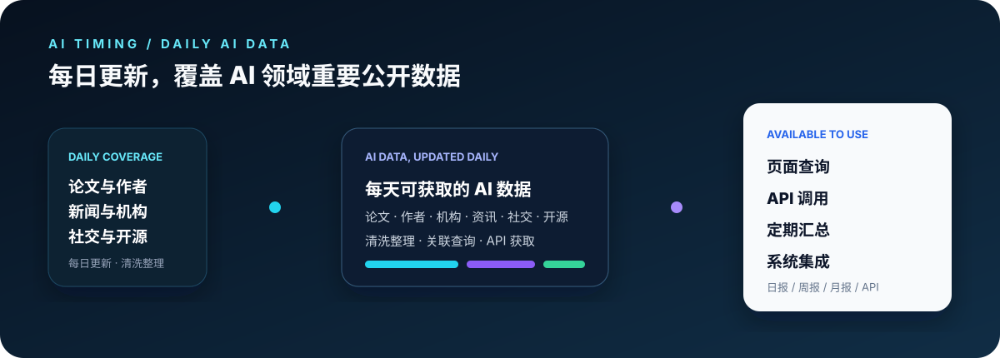
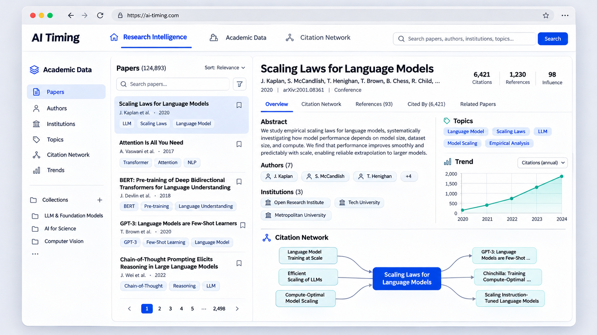
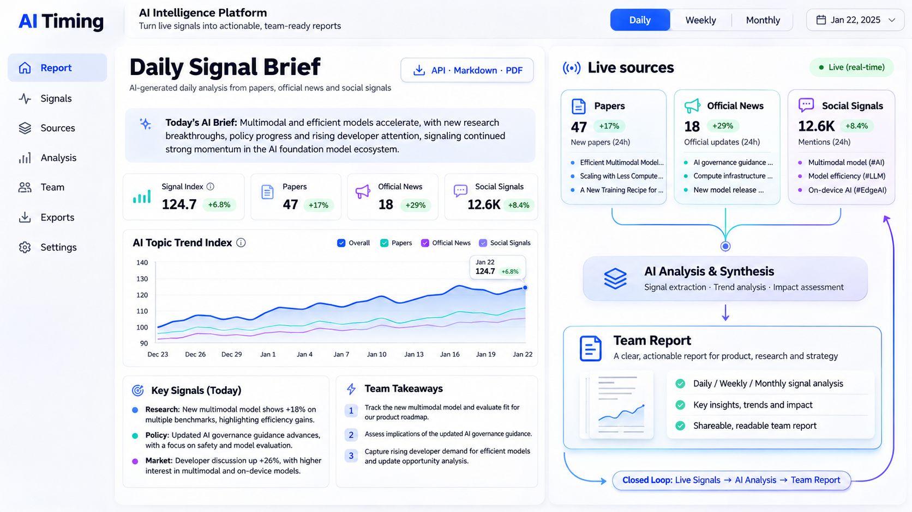
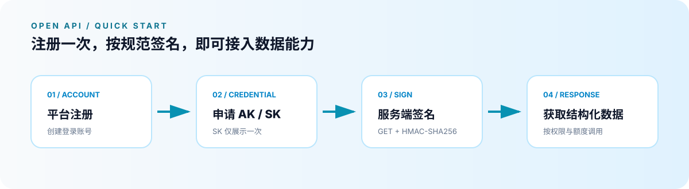
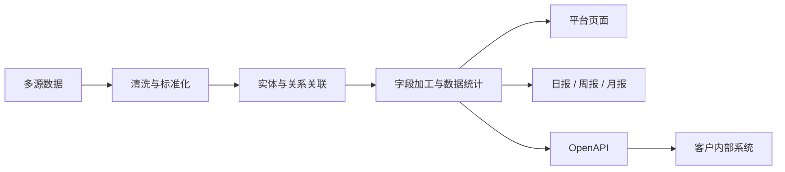
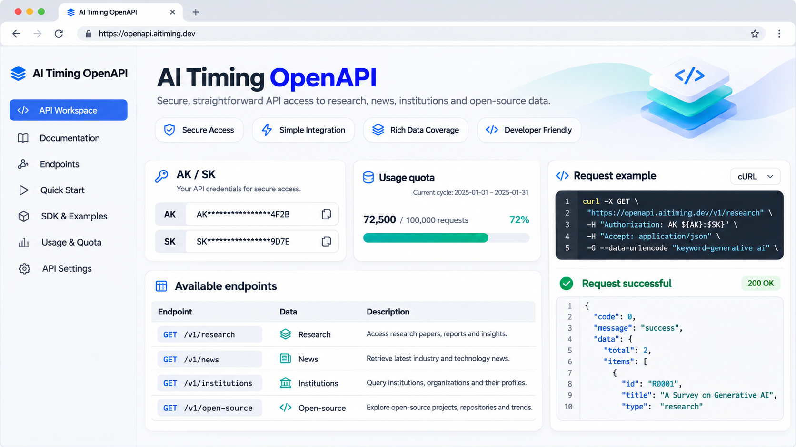

# AI Timing

[English](./README.md) | **简体中文**

> 提供 AI 论文、人物、机构、资讯、社交与开源数据查询和 API 服务

[](https://aitiming.tech/platform)
[](https://aitiming.tech/open-api)

AI Timing 汇集论文、学者、机构、新闻、社交媒体和开源项目等公开与授权信息，完成字段统一、去重、实体关联和每日同步。数据可在平台查询，也可通过 API 接入业务系统。



## 能提供什么数据

| 数据域 | 主要内容 | 适合解决的问题 |
|---|---|---|
| 论文数据 | 论文标题、摘要、作者、机构、发布时间、引用与主题标签 | 按作者、机构、主题、日期筛选论文 |
| 资讯数据 | AI 领域新闻标题、摘要、来源、时间与分类 | 按来源和日期查看资讯，生成定期汇总 |
| 机构数据 | AI 相关企业、组织、实验室与关联信息 | 查看机构资料、关联论文、人员和项目 |
| 社交媒体数据 | 公开讨论、发布时间、来源、话题与互动信息 | 查看某个话题、人物或项目的公开讨论 |
| 开源数据 | 项目、代码仓库、描述、标签和社区互动指标 | 查询项目资料、仓库信息和互动数据 |

以上数据经过清洗和结构化处理，持续更新并每日同步。作者、机构、论文、项目与资讯之间保留可查询的关联关系，适合直接阅读，也可以通过 API 接入自己的系统、脚本或自动化工具。

## 产品页面预览

### 论文、作者与机构



论文列表可继续查看作者、机构、主题、引用记录和关联关系，方便从一条记录跳转到相关数据。

### 日报、周报与月报



将当天或指定时间范围内的论文、资讯和社交内容整理为日报、周报和月报，支持页面查看、分享、下载和后续自动化处理。

## 常见使用方式

### 论文与作者查询

- 按主题、机构、作者和时间筛选论文
- 查看引用、作者合作与机构关联信息
- 整理课程、论文写作和资料汇总所需的公开材料

### 机构、项目与资讯查询

- 查询机构、实验室、人员和开源项目资料
- 按日期和来源查看 AI 新闻、社区讨论与项目更新
- 将同一主题下的论文、资讯、项目和人员记录放在一起查看

### 产品与商业工作

- 用于产品调研、技术选型、合作对象筛选和客户资料补充
- 查询竞品、项目、机构和行业公开信息
- 将数据接入 BI、知识库、内部检索、CRM 或自研应用

### 个人开发者与独立创作者

- 为个人产品、内容选题和垂直领域整理可引用的公开资料
- 为主题、人物、机构或开源项目建立持续查询清单
- 将 API 接入自己的脚本、Agent、Newsletter 或自动化工作流

### 定期汇总与自动化

- 日报、周报和月报预览与定期更新
- 把指定时间范围内的论文、新闻、社交讨论和项目记录集中整理
- 通过服务端 API 调用，支持自动化分析和定时任务

## 数据处理与输出方式





## OpenAPI 接入



### 申请 AK / SK

1. 访问 [AI Timing 平台](https://aitiming.tech/platform)，注册并登录账号
2. 进入 [开放接口](https://aitiming.tech/open-api)
3. 先阅读免登录的[用户操作手册](https://aitiming.tech/open-api/guide)
4. 在“凭证管理”中创建 AK / SK
5. Secret Key 只在创建或轮换成功时展示一次，请立即复制并保存在服务端安全环境变量中
6. 在“可用接口”中查看当前账号已开放的接口、额度周期、已使用次数和剩余次数

> 凭证管理、创建 AK / SK 和可用接口需要登录；用户操作手册可直接公开查看。

### 高校与研究机构额度支持

高校教师、实验室及科研机构如因课程教学、课题研究、实验室数据服务或内部系统联调需要更高的 API 调用额度，可扫描文末客服二维码添加好友，或发送邮件至 `market@qingwuinfo.cn`。联系时请简要说明机构或团队名称、使用场景、预计调用量和接口需求，我们会根据实际用途评估并协助开通更合适的额度与接入支持。

## 作者的话

我们做这个项目的初衷很简单：把分散在论文、新闻、社交媒体和开源社区里的信息，整理成大家真正能读懂、能关联、能继续使用的数据。

如果 AI Timing 对你的课程、实验室、产品或个人项目有帮助，欢迎使用，也欢迎告诉我们哪里还不够好。我们希望它是一个学生、教师、工程师、创业者和独立创作者都能低成本使用的工具。

AI Timing 目前是一个由兴趣驱动、以低成本维护的项目。免费 API 会设置合理的调用次数、频率和并发限制，用来保证公共服务稳定运行。学生、教师、开源项目和早期独立开发者如果有更高调用量、批量数据或特殊接入需求，可以通过下方官方联系方式说明用途，我们会根据实际情况评估开放更多限流或提供联调支持。

### 调用地址

```text
API Base:  https://aitiming.tech/api
Open API: https://aitiming.tech/api/openapi/v1
```

### 调用规则

当前开放业务接口遵循以下规则：

- 仅支持 `GET` 请求，暂不支持请求体
- 请求必须在用户自己的服务端完成签名，不要在浏览器、App 或公开仓库中暴露 SK
- 每次请求都要重新生成 10 位秒级时间戳、唯一 `nonce` 和签名
- 管理平台接口使用登录 Token；业务开放接口使用 AK / SK 签名，两套鉴权不要混用
- 签名路径使用 `/openapi/v1/**`，不包含部署前缀 `/api`
- 查询参数需要按协议生成 `CanonicalQuery`，参数名排序、URL 编码和空值处理必须保持一致
- 频率、用户额度、接口每日总额度、并发数和临时封禁均由平台策略控制
- 收到 `429` 时按响应提示等待后再重试，不要进行密集并发重试

必填请求头：

| Header | 说明 |
|---|---|
| `X-OpenApi-Access-Key` | 平台签发的 AK |
| `X-OpenApi-Timestamp` | 10 位 Unix 秒级时间戳 |
| `X-OpenApi-Nonce` | 每次请求唯一的随机字符串 |
| `X-OpenApi-Signature` | HMAC-SHA256 签名结果 |
| `X-OpenApi-Sign-Version` | 当前固定为 `v1` |

### Python 调用骨架

下面示例只展示调用结构，`AK`、`SK` 和接口路径请替换为平台实际分配的值。完整 CanonicalQuery、签名串和错误处理请以[用户操作手册](./docs/open-api-user-guide.md)为准。

```python
import hashlib
import hmac
import os
import secrets
import time
import urllib.parse

import requests

BASE_URL = "https://aitiming.tech/api"
AK = os.environ["AITIMING_ACCESS_KEY"]
SK = os.environ["AITIMING_SECRET_KEY"]
PATH = "/openapi/v1/papers"
RAW_QUERY = "page=1&pageSize=20"  # 不含开头的 ?

def rfc3986_encode(value: str) -> str:
    value = urllib.parse.unquote_plus(value, encoding="utf-8")
    return urllib.parse.quote(value, safe="-._~", encoding="utf-8")

def canonical_query(raw_query: str) -> str:
    if not raw_query:
        return ""
    pairs = []
    for pair in raw_query.split("&"):
        raw_name, separator, raw_value = pair.partition("=")
        if not separator:
            raw_value = ""
        pairs.append((rfc3986_encode(raw_name), rfc3986_encode(raw_value)))
    pairs.sort()
    return "&".join(f"{name}={value}" for name, value in pairs)

timestamp = str(int(time.time()))
nonce = secrets.token_hex(16)
empty_body_sha256 = hashlib.sha256(b"").hexdigest()
canonical_request = "\n".join([
    "OPENAPI-HMAC-SHA256", "v1", "GET", PATH,
    canonical_query(RAW_QUERY), timestamp, nonce, empty_body_sha256,
])
signature = hmac.new(SK.encode("utf-8"), canonical_request.encode("utf-8"), hashlib.sha256).hexdigest()

response = requests.get(
    BASE_URL + PATH + "?" + RAW_QUERY,
    headers={
        "X-OpenApi-Access-Key": AK,
        "X-OpenApi-Timestamp": timestamp,
        "X-OpenApi-Nonce": nonce,
        "X-OpenApi-Signature": signature,
        "X-OpenApi-Sign-Version": "v1",
    },
    timeout=30,
)
response.raise_for_status()
print(response.json())
```

> 说明：上面代码中的签名串是接入结构示意。正式接入必须完整遵循手册中的 CanonicalQuery、空请求体摘要和待签名串规则，不要直接把示意代码当作生产签名实现。

## 响应与错误处理

成功响应通常包含统一结构：

```json
{
  "code": 200,
  "message": "操作成功",
  "data": {}
}
```

常见状态：

| 状态 | 含义 | 建议 |
|---|---|---|
| `200` | 调用成功 | 读取 `data` |
| `401` | AKSK 认证失败或时间戳失效 | 检查 AK、签名版本、时间戳和签名串 |
| `403` | 当前账号没有接口权限 | 联系管理员配置接口和用户等级策略 |
| `404` | 路径不存在或接口未开放 | 核对 `/openapi/v1/**` 路径 |
| `429` | 频率、额度、并发或临时封禁 | 按提示时间等待后有限重试 |
| `500/503` | 服务端或保护依赖异常 | 记录请求 ID，退避重试并联系我们 |

## 详细文档

- [OpenAPI 用户接入与调用操作手册](./docs/open-api-user-guide.md)
- [AI Timing 平台](https://aitiming.tech/platform)
- [开放接口入口](https://aitiming.tech/open-api)

## 联系与申请

如果需要申请接口权限、确认数据范围、获取商务方案或进行技术联调，请联系：

- 邮箱：`market@qingwuinfo.cn`
- 电话：`19925333250`
- 平台首页：<https://aitiming.tech/platform>
- 发现页：<https://aitiming.tech/>


## 版本边界

- 开放业务接口当前以 `GET` 为主，具体可调用路径以用户工作台实时列表为准
- AK / SK 创建、轮换、启用和禁用需要登录
- 开放接口的启用、等级策略、总额度、调用日志、通知和封禁由管理员管理
- 不要将真实 AK、SK、Token 或生产数据提交到 GitHub

---

AI Timing · Catch the signals before the world does

[English](./README.md) | [简体中文](./README.zh-CN.md)
